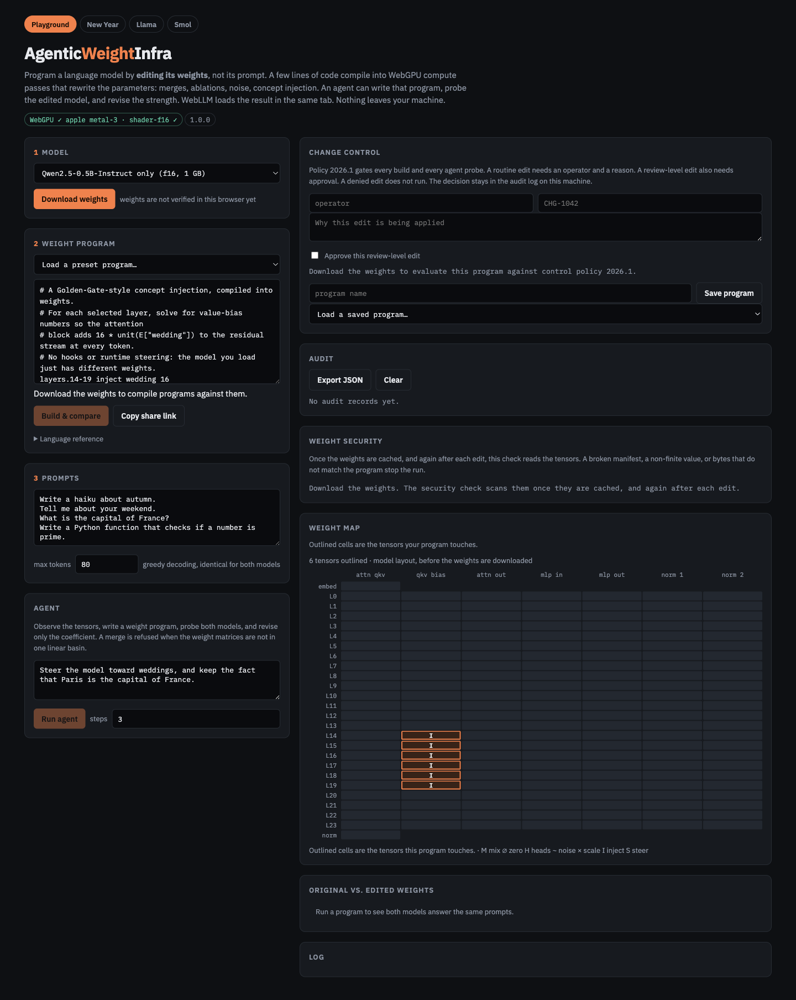
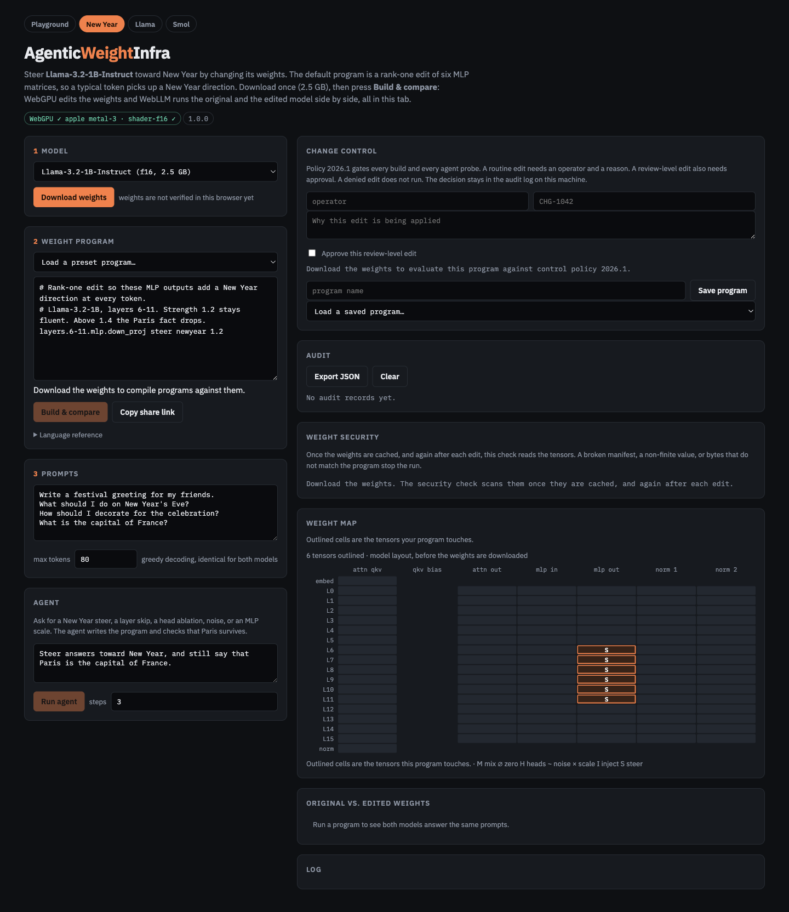
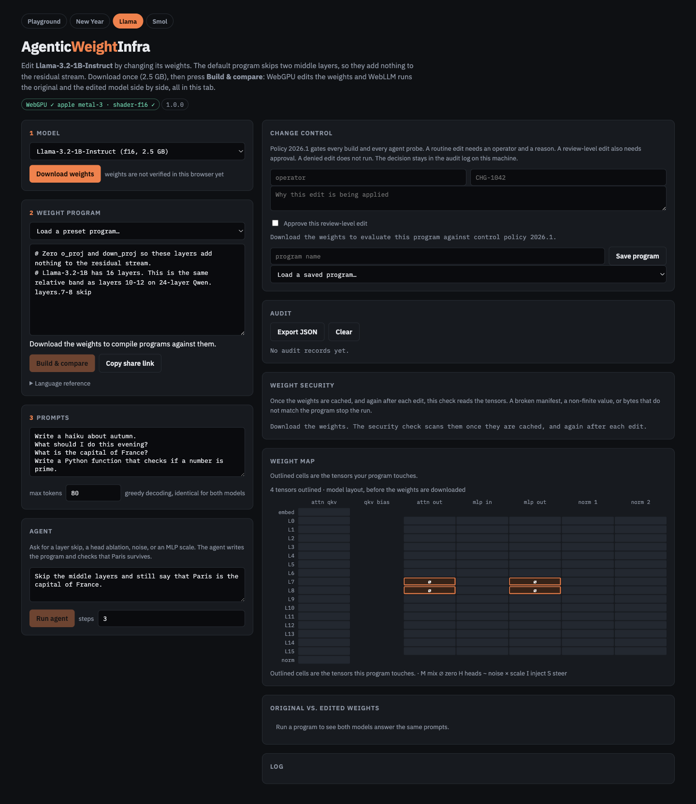
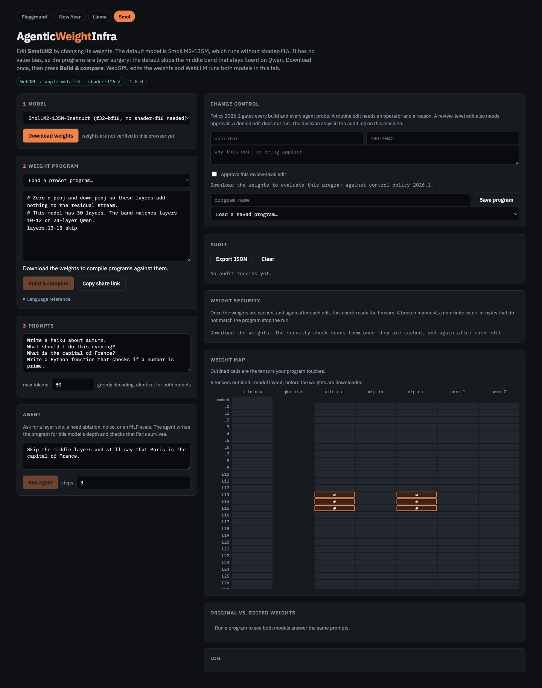

# AgenticWeightInfra

**An agent edits an LLM by rewriting its weights, in the browser.**

**Playground:** the pages in this folder · **Articles:** [Weight-Space Programming in a Browser Tab](docs/weight-space-programming.md) · [Deep Dive Tutorial](docs/weight-space-programming-deep-dive.md)

AgenticWeightInfra is a weight-space programming runtime. A small weight language compiles into WebGPU compute passes. Those passes rewrite a model's parameters in the WebLLM cache, and WebLLM then runs the edited model in the same tab. There is no server, no fine-tuning, and nothing is uploaded.

It draws its inspiration from weight-space programming (WSP), the MIT CSAIL project in which a language model reads and writes another network's weights directly, without gradient descent or a training loop. Rikiya Takehi, Jayden Teoh, Alex Zhang, and Omar Khattab introduced that idea in November 2026.

- [Weight-space programming](https://en.wikipedia.org/wiki/Weight-space_programming) (Wikipedia)
- [Sparks of Weight-Space Programming](https://rikiyat.github.io/blog/weight-space-programming/) (Rikiya Takehi, Jayden Teoh, Alex Zhang, and Omar Khattab, MIT CSAIL)

An agent sits on that runtime. It observes which edits the loaded model can actually express, writes a program, probes the original and the edited model on the same prompts, and revises only the coefficient. The search bounds are the ones the reference runs measured: concept injection collapses when it is too strong, a steer that is pushed too far loses fluency and facts, and a straight mix of Qwen Instruct and Qwen Coder falls off a cliff.

```
# Golden-Gate-style concept injection, compiled into 768 bias numbers
layers.14-19 inject wedding 16
```

*(PyTorch reference run on the same weights)*

> **Q:** What is the capital of France?
> **Original:** The capital of France is Paris.
> **After the weight program:** The capital of France is Paris. It is a city … known for its wedding ceremony and wedding ring …

## The tabs

`npm start` serves four pages at `http://127.0.0.1:8080`. They share one layout.

The left column is the edit. **Model** picks the checkpoint. **Weight program** is the language, with a preset menu above the editor. **Prompts** are asked of both models with the same greedy decode. **Agent** writes a program from a goal and revises only the coefficient.

The right column is the record of that edit. **Change control** asks for an operator, a ticket, and a reason, and holds a review-level edit until it is approved. **Audit** is the local log of those decisions. **Weight security** is the load scan and the post-edit check. **Weight map** outlines every tensor the program touches. **Original vs. edited weights** is where the two answers land. **Log** is the run transcript.

### Playground



The [Playground](./index.html) is the Qwen page. It opens on **Qwen2.5-0.5B-Instruct** with the wedding injection, because that model has a value bias and the injection compiles into it:

```
layers.14-19 inject wedding 16
```

The model menu also has the pair, Qwen2.5-0.5B-Instruct plus the donor Qwen2.5-Coder-0.5B-Instruct. `mix` is available only on that pair. The presets cover a second injection word, the 50/50 merge cliff, a 10% step toward Coder, a full swap, grafting the layer norms, skipping layers 10–12, skipping the early layers 4–6, zeroing half the attention heads, 5% weight noise, and scaling the MLP outputs.

### New Year



The [New Year tab](./new-year.html) steers **Llama-3.2-1B-Instruct**. The default program is a rank-one edit of six MLP down-projections, loaded from `vectors/newyear.Llama-3.2-1B-Instruct.json`:

```
layers.6-11.mlp.down_proj steer newyear 1.2
```

The prompts ask for a festival greeting, New Year's Eve, decorations, and the capital of France. The agent goal is the same steer, with Paris kept. The other presets on this tab are the Llama layer-surgery programs below. Qwen has no New Year pack, so the agent refuses that goal on the Playground. The shipped vector file is the previous direction with the name changed. Rebuild it with `python tools/make_steer_vector.py --name newyear` before reading the answers as a New Year result.

### Llama



The [Llama tab](./llama.html) edits **Llama-3.2-1B-Instruct**. The default program skips two middle layers. Zeroing `o_proj` and `down_proj` makes those layers add nothing to the residual stream:

```
layers.7-8 skip
```

Llama-3.2-1B has 16 layers. Layers 7–8 are the same relative band as layers 10–12 on the 24-layer Qwen, the band that stays fluent in the reference run. Skipping the early band (`layers.3-4`) is the one that confuses the model. The other presets zero half of the 32 attention heads, add 5% weight noise, or scale the MLP outputs.

`steer` is still in the language. It is a rank-one edit, `W += c · outer(u, a/|a|²)`, loaded from a vector pack built by [`tools/make_steer_vector.py`](tools/make_steer_vector.py). This model has no attention value bias, so `inject` does not apply here.

### Smol



The [Smol tab](./smol.html) edits **SmolLM2**. The default model is SmolLM2-135M-Instruct, the build that runs without shader-f16. SmolLM2-360M-Instruct is the larger sibling on the same tab. Neither has a value bias or a same-architecture donor, so the programs are layer surgery, not concept injection and not a merge.

Switching models rewrites a loaded preset for that model's depth. On the 30-layer 135M, the fluent middle band is `layers.13-15`. On the 32-layer 360M it is `layers.13-16`. Both are the same relative band as layers 10–12 on 24-layer Qwen. The head preset zeros the first half of that model's query heads: 0–3 of 9 on the 135M, 0–6 of 15 on the 360M.

## Run it

```bash
npm test    # language, injection, agent, control, security, cache, and the static server
npm start   # http://127.0.0.1:8080  (Chrome or Edge, WebGPU + shader-f16)
```

`npm start` serves this directory with `tools/serve.mjs`. It does not list directories, it refuses a path that leaves the site root, and it sends a content security policy. Scripts stay on this origin except the pinned WebLLM package. Weight downloads are allowed over HTTPS, which is where the MLC shards live. A shard is kept only when the stored byte length matches the manifest; a short or cancelled download is deleted and does not count as cached.

1. Pick a model and click **Download weights**. The weights go into WebLLM's own browser cache: 2 × 1 GB for the Qwen pair, once.
2. Load a preset or write a program. The weight map outlines every tensor the program touches, including the embedding and the final norm. It uses the model layout at once, then the cached tensor list after the weights download.
3. Click **Build & compare**. The program runs on the GPU. The security check then reads the patched bytes and refuses to load them when they do not match the program. WebLLM runs the original and the edited model on the same prompts with greedy decoding.
4. Click **Copy share link** to share the program in the URL (`#m=…&p=…&q=…&g=…`).
5. Or write a goal and click **Run agent**. The agent fills the program box, builds it, and revises the strength from the answers. Download the weights first. The loop does not call a remote model.

## Layout

```
src/infra/     weight language, f16/bf16 codec, cache, injection solve, steer packs, patched-model build
src/kernels.js WebGPU apply and cosine-reduction shaders
src/agent/     policy, probe rubric, session loop, tool dispatch
src/security/  load scan and post-edit attestation of the cached tensors
src/catalog.js model menu and the preset programs
src/app.js     playground: the same pages, now able to host the session
tools/         make_steer_vector.py, the offline pack builder; serve.mjs, the static server
vectors/       shipped steering packs
```

`src/weightspace.js` re-exports the runtime. Cache keys are unchanged (`webllm/model`, `wsp-models/wsp-<hash>`), so a program built before this split still loads.

## The agent

The session is observe → diagnose → edit → test.

| Phase | What it uses |
|---|---|
| Observe | Layer count, value biases, donor, shipped steering packs |
| Diagnose | The goal, plus the donor cosine map when a merge was asked for |
| Edit | One weight program, compiled against the real tensor list |
| Test | Greedy answers on your prompts. The rubric looks for the concept, for "Paris" on a France prompt, and for repetition collapse |

It will not do three things the reference runs showed were wrong:

- Inject a concept into a model with no value bias and no steering pack for that concept.
- Globally mix Instruct and Coder when the big matrices have mean cosine under 0.6. It grafts norms and attention biases instead. Ask for the cliff (`mix 0.5`, "midpoint") if you want that failure on purpose.
- Raise a coefficient into the collapse regime. Inject searches 4–20. A shipped steer pack searches 0.4–1.4. Noise, skips, head ablations, and scales are one probe, not a search.

An external driver can call the same decisions without the page. `dispatchTool` in `src/agent/tools.js` covers `observe_model`, `compile_program`, `propose_edit`, `revise_edit`, `score_answers`, `attest_weights`, and `run_session`. Mapping tensors and building the patched model stay with the host, because those need the GPU.

## Weight security

The check runs when a model finishes loading, and again after every build, before WebLLM loads the patched model.

On load it checks the manifest (dtype, byte ranges, overlaps, layer indices) and scans every stored value. A non-finite value denies the run. An all-zero weight matrix, or a finite peak above 64, is reported for review and does not block.

After an edit it checks three things. Shards the program does not touch must still point at the original bytes. Tensors outside the program that share a rewritten shard must be byte-identical. Tensors inside the program must match the op: a zero is actually zero, a scale moves the norm by that factor, a mix matches `base + a·(donor − base)` within 1%, and an injection or steer matches the vector that was solved for the program. Noise is review when the relative move is larger than `4|s| + 0.05`, or when cosine falls below 0.85 at a strength of 0.3 or less. A denied check is written to the audit log and the patched model is not loaded.

## Change control

Policy `2026.1` runs on every build and every agent probe. The thresholds are the same ones the reference runs measured.

| Decision | When |
|---|---|
| Allow | A narrow edit inside the routine bounds, with an operator and a reason |
| Review | Full-model mix, noise above 12%, injection above 20, steer above 1.4, an early-layer skip, more than half the heads, scale outside 0.5–1.5, or more than half the parameters |
| Deny | A wipe of `*` or `embed`, noise above 30%, injection above 24, steer above 2, scale outside `(0, 3]`, or a full-model mix outside 0–1 |

A review-level edit runs only after the approval checkbox is checked. That approval, and every blocked attempt, is appended to the local audit log. The log exports as JSON. Named programs can be saved and loaded on the same machine. Nothing in this record leaves the browser.

## The language

`<selector> <op> [args]`, one rule per line. Rules apply in order.

| selector | matches |
|---|---|
| `*` | every tensor |
| `embed` | token embedding (tied to the output head in these models) |
| `layers.10-13` | everything in layers 10..13 |
| `layers.*.mlp`, `layers.*.attn.o_proj`, `layers.0-5.*norm` | sub-modules, globs inside a segment |

| op | effect |
|---|---|
| `mix a` | `w += a·(donor − base)`: merging and task arithmetic (a<0 negates, a>1 extrapolates) |
| `scale k` | `w *= k` |
| `zero` | `w = 0` |
| `noise s` | `w *= 1 + s·N(0,1)` |
| `skip` | zero `o_proj` + `down_proj`, so the layer becomes an identity on the residual stream |
| `zero-heads a-b` | zero attention heads a..b (their input columns in `o_proj`) |
| `inject word c` | concept injection: per layer, solve least-squares for value-bias deltas so the attention block adds `c·unit(E[word])` to the residual stream at every token |
| `steer concept c` | rank-one edit of `mlp.down_proj` from a vector pack `vectors/<concept>.<model>.json`: `W += c·outer(u, a/\|a\|²)` |

### How `inject` works

Qwen2 has a bias on the value projection. Attention weights sum to 1, so a value bias passes straight through attention: `Σ aᵢ(vᵢ + b) = Σ aᵢvᵢ + b`. After `o_proj`, it becomes a **constant vector added to the residual stream at every position**. With grouped-query attention (14 query heads, 2 KV heads, head dim 64), each layer can write any vector in a 128-dimensional subspace. We solve `min‖M·x − s‖` (M = grouped `o_proj` columns, s = scaled embedding of the word; the embedding doubles as the unembedding because they are tied). The result goes into 128 numbers per layer. It is activation steering compiled into the weights, so no runtime hooks are needed.

## How it plugs into WebLLM (no fork)

WebLLM keeps model files in Cache Storage (`webllm/model`, `webllm/config`), keyed by URL.

1. The original MLC shards are downloaded into those caches under their normal Hugging Face URLs.
2. For each shard that holds an edited tensor, the bytes go through the WebGPU kernels (`src/kernels.js`). Values are packed as two 16-bit numbers per `u32` and decoded with `unpack2x16float` or bf16 bit shifts, so the kernels don't need `shader-f16`. The edited shard is written under a synthetic URL (`./wsp-models/wsp-<hash>/resolve/main/`).
3. The new `tensor-cache.json` points untouched shards at the **original absolute URLs**, so nothing is copied. A concept injection writes about 180 MB of new shards. A full merge writes about 1 GB.
4. A model record with that URL and the **same compiled model library** is passed to `CreateMLCEngine`. Every file is already in the cache, so it loads with zero network requests.

## Supported models

Unquantized MLC builds only (`q0f16`, `q0f32`). Quantized `q4f16` weights would need dequantising and requantising first.

- Qwen2.5-0.5B-Instruct + Qwen2.5-Coder-0.5B-Instruct (same architecture and model library, so `mix` works)
- SmolLM2-135M-Instruct and SmolLM2-360M-Instruct, on the Smol tab (layer skip, heads, noise, scale; no attention biases, so no `inject`)
- Llama-3.2-1B-Instruct, on the Llama tab (layer skip, heads, noise, scale)

## Findings from a PyTorch reference run (same weights, greedy decoding)

- **Concept injection:** `layers.14-19 inject wedding 16` steers answers toward weddings and stays fluent. At 8 the effect is barely visible. Each word has its own sweet spot: "ocean" or "cats" at 16–20 collapses into repeating the word.
- **The merge cliff:** α = 0 (Instruct) and α = 1 (Coder) both work. α = 0.1, 0.3 and 0.5 all produce degenerate loops. The weight map shows why: the matrices have cosine similarity of only 0.2–0.45, while the norms and biases are about 0.99. These two siblings don't sit in a linearly connected basin.
- **Layer surgery:** skipping layers 10–12 keeps the model fluent. Skipping layers 4–6 makes it confused.
- **Noise:** 5% multiplicative noise is survivable. At 12% answers drift off topic. At 30% the output is noise.

Verified in headless Chromium (WebGPU): kernel outputs match NumPy (mix, scale, zero-heads, add-vector, bf16 path, cosine reduction). The injected biases match the PyTorch least-squares solution, and WebLLM loads the edited model from cache with no network access.

---

AgenticWeightInfra is independent software, provided as is, without warranty of any kind. It is inspired by weight-space programming research and is not affiliated with, endorsed by, or a product of MIT, CSAIL, or the authors of that work. Names, papers, and trademarks cited here belong to their respective owners. Model weights (Qwen, Llama, SmolLM, and others) remain the property of their owners and are subject to those owners' licenses.
